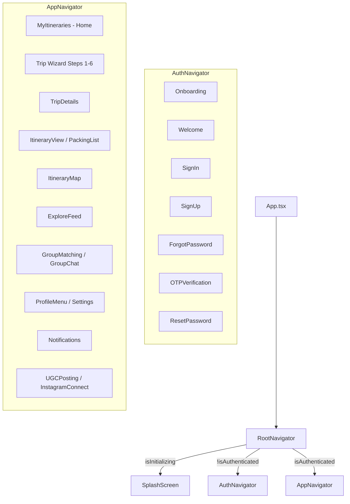

# TourbhookMobile — Architecture and Project Structure Guide

## 1. Architectural Overview

**TourbhookMobile** is a production-grade travel planning and community mobile application built with **React Native CLI** (targeting Android and iOS). The architecture follows a modular, feature-driven pattern with a centralized core foundation:

```
TourbhookMobile/
├── App.tsx                     # Top-level application bootstrap & providers
├── index.js                    # Entry point registering Root component
├── app.json                    # Application identity & display name
├── package.json                # Project dependencies & scripts
├── assets/                     # Packaged static fonts & brand image assets
├── android/                    # Android native project (Gradle, Kotlin/Java, Manifest)
├── ios/                        # iOS native project (CocoaPods, Xcode workspace)
├── docs/                       # Project architecture & audit documentation
├── scratch/                    # Historical migration scripts & upstream source (preserved)
└── src/
    ├── core/                   # Application-wide infrastructure & shared primitives
    └── features/               # Domain-specific feature modules
```

---

## 2. Application Entry Points & Provider Hierarchy

### 2.1 Initialization Chain
1. **`index.js`**:
   Registers the root `App` component with `AppRegistry.registerComponent(appName, () => App)`.
2. **`App.tsx`**:
   Configures top-level application infrastructure:
   - Enforces a hidden status bar globally (`StatusBar.setHidden(true)`).
   - Wraps the screen tree with essential providers in strict hierarchical order:

```tsx
<QueryClientProvider client={queryClient}>
  <AuthProvider>
    <SafeAreaProvider>
      <StatusBar hidden={true} barStyle={isDarkMode ? 'light-content' : 'dark-content'} />
      <RootNavigator />
    </SafeAreaProvider>
  </AuthProvider>
</QueryClientProvider>
```

### 2.2 Providers
- **`QueryClientProvider` (`src/core/query/queryClient.ts`)**: TanStack React Query client managing server state, caching, and background refetching.
- **`AuthProvider` (`src/core/auth/AuthContext.tsx`)**: Global auth state tracking (`isAuthenticated`, `isInitializing`, `user`), session restoration from persistent storage on startup, and mock login support.
- **`SafeAreaProvider` (`react-native-safe-area-context`)**: Handles safe inset dimensions across device notches, home bars, and dynamic status bars.

---

## 3. Core Infrastructure (`src/core/`)

The `src/core/` directory contains shared services, components, and utilities that do not belong to a single business feature:

| Directory | Responsibilities | Key Files |
| :--- | :--- | :--- |
| **`api/`** | Central Axios HTTP client, request/response interceptors, auth token refresh queue, base URLs, standard exceptions, and API models. | `apiClient.ts`<br/>`apiConstants.ts`<br/>`apiExceptions.ts`<br/>`apiTypes.ts` |
| **`auth/`** | Authentication React Context, session restoration logic, user model interfaces, and authentication Zustand store. | `AuthContext.tsx`<br/>`authModels.ts`<br/>`authStore.ts`<br/>`session.ts` |
| **`components/`** | Reusable design system UI components shared across all feature modules. | `ActionOptionRow.tsx`<br/>`AppLogo.tsx`<br/>`BackButton.tsx`<br/>`BottomNavBar.tsx`<br/>`ConfirmationModal.tsx`<br/>`CustomModal.tsx`<br/>`CustomTextField.tsx`<br/>`EmptyState.tsx`<br/>`ErrorState.tsx`<br/>`FeedbackToast.tsx`<br/>`PrimaryButton.tsx`<br/>`SkeletonBlock.tsx` |
| **`navigation/`** | Root, authentication, and application stack navigators, plus centralized TypeScript route parameter definitions. | `RootNavigator.tsx`<br/>`AuthNavigator.tsx`<br/>`AppNavigator.tsx`<br/>`types.ts` |
| **`query/`** | TanStack React Query client configuration and singleton instance. | `queryClient.ts` |
| **`storage/`** | Persistent key-value storage wrapper using `@react-native-async-storage/async-storage` for auth tokens, refresh tokens, and user profiles. | `tokenStorage.ts` |
| **`theme/`** | Design system color palette tokens (`AppColors`), typography font family definitions, and global style constants. | `colors.ts`<br/>`typography.ts`<br/>`index.ts` |

---

## 4. Feature Modules (`src/features/`)

Business features are organized into isolated domain directories under `src/features/`. Each feature encapsulates its own screens, components, Zustand stores, API services, types, and automated tests.

```
src/features/
├── auth/                       # Onboarding & authentication flows
├── events/                     # Travel events feed & event details
├── explore/                    # Destination discovery, Reels, & collections
├── groups/                     # Travel groups, matching, chat, & access control
├── imports/                    # Third-party travel itinerary ingestion & review
├── notifications/              # In-app notifications & news feed updates
├── profile/                    # User profile, settings, gamification, & payments
├── reviews/                    # Destination & place reviews
├── trips/                      # End-to-end trip creation wizard, itinerary & packing
└── ugc/                        # User Generated Content (reels, posts, social connect)
```

### Feature Breakdown

#### 1. `trips/` (Core Itinerary Engine)
- **Wizard Flow (Steps 1–6)**:
  - Step 1: `PlanTripScreen.tsx` — Destination search, traveler type (solo, couple, family, group), adult/child count, travel dates, primary traveler age, and medical requirements.
  - Step 2: `TripPreferencesScreen.tsx` — Travel style (Budget Friendly, Fast Travel, Relaxed Vacation, Explore Everything).
  - Step 3: `TripSummaryScreen.tsx` — Review configured trip details before generation.
  - Step 4: `AddPlacesScreen.tsx` — Add curated or searched attractions to the trip.
  - Step 5: `TravelModeScreen.tsx` — Select transit modes (Airplane, Boat, Bus, Car, Public Transport, Train).
  - Step 6: `CheckingPackingScreen.tsx` — Itinerary creation synthesis & transition to packing.
- **Trip Viewing & Management**:
  - `MyItinerariesScreen.tsx` — User's saved trips list (active, past, draft).
  - `TripDetailsScreen.tsx` — Overview of an existing trip.
  - `PlaceDetailsScreen.tsx` — Details for specific places within an itinerary.
  - `ItineraryPackingScreen.tsx` — Dual-tab screen managing the day-by-day itinerary schedule and the trip packing checklist.
  - `ItineraryMapScreen.tsx` — Interactive map displaying route coordinates, day markers, and transit polyline paths using `react-native-maps`.
- **State & Services**:
  - `itineraryStore.ts` — Zustand store for itineraries, day schedules, and places.
  - `itineraryPackingStore.ts` — Zustand store for categorized packing items and checklist completion progress.
  - `destinationAutocompleteService.ts` — Destination search service with fallback curated recommendations.
  - `itineraryRouteService.ts` — Route coordinate calculations and distance estimation.

#### 2. `auth/` (Authentication & Onboarding)
- **Screens**: `SplashScreen`, `OnboardingScreen`, `WelcomeScreen`, `SignInScreen`, `SignUpScreen`, `ForgotPasswordScreen`, `OTPVerificationScreen`, `ResetPasswordScreen`.
- **Services**: `onboardingStorage.ts` (tracks onboarding completion in AsyncStorage).

#### 3. `explore/` (Discovery & Travel Reels)
- **Screens**:
  - `ExploreFeedScreen.tsx` — Search bar, category filters (Adventure, Culture, Food, Beach, Nature), travel reels carousel, popular destinations, and suggested travel groups.
  - `ReelViewerScreen.tsx` — Full-screen vertical video / reel viewer with likes, bookmarks, and place links.
  - `DestinationDetailsScreen.tsx` — Destination hero overview, quick info, season guide, and popular places.
  - `AllDestinationsScreen.tsx` — Filterable grid of worldwide destinations.
  - `ExploreCollectionScreen.tsx` — Curated collections.
- **Data & Services**: `mockExploreData.ts`, `exploreVoiceSearchService.ts`.

#### 4. `groups/` (Community & Group Matching)
- **Screens**: `GroupMatchingScreen`, `CreateGroupScreen`, `EditGroupScreen`, `GroupDetailsScreen`, `GroupChatScreen`, `GroupInfoScreen`.
- **Components & Utils**: `GroupAccessGateModal.tsx`, `GroupAccessBadges.tsx`, `groupAccess.ts` (manages public vs private/level-gated community access).
- **Data**: `groupStore.ts` (Zustand store for group creation, membership, and chat messages).

#### 5. `profile/` (Account, Gamification & Subscriptions)
- **Screens**: `ProfileMenuScreen`, `ProfileSettingsScreen`, `LanguageScreen`, `UserLevelsScreen`, `UpgradePlanScreen`, `PaymentMethodsScreen`, `PaymentDetailsScreen`, `HelpSupportScreen`, `PrivacyPolicyScreen`, `TermsScreen`.
- **Data Stores**: `userLevelStore.ts` (XP, traveler badges, levels), `subscriptionStore.ts` (Free, Explorer, Pro tiers), `languageStore.ts` (selected app locale).

#### 6. `ugc/` (User Generated Content)
- **Screens**: `UGCPostingScreen.tsx` (create/share reels and travel tips), `InstagramConnectScreen.tsx` (Instagram creator account linking).
- **Services**: `instagramService.ts`, `ugcService.ts`.

#### 7. `notifications/`
- **Screens**: `NotificationsScreen.tsx` (categorized alerts: updates, trips, community, reviews).
- **Utilities**: `newsShareFormatting.ts`.

#### 8. `events/`
- **Screens**: `EventsFeedScreen.tsx`, `EventDetailsScreen.tsx`.
- **Data**: `mockEventsData.ts`.

#### 9. `imports/`
- **Screens**: `ImportDataScreen.tsx`, `ImportReviewScreen.tsx` (importing itineraries from external formats or URLs).

#### 10. `reviews/`
- **Screens**: `ReviewsScreen.tsx` (submitting and viewing ratings and reviews for attractions).

---

## 5. Navigation Flow & Navigator Hierarchy

Navigation is orchestrated using `@react-navigation/native` and `@react-navigation/native-stack`:



### Navigator Responsibilities
1. **`RootNavigator` (`src/core/navigation/RootNavigator.tsx`)**:
   - Evaluates `useAuth()` state.
   - Shows `SplashScreen` during async session restoration.
   - Conditionally mounts either `AuthNavigator` or `AppNavigator`, ensuring unauthorized users cannot access application screens.
2. **`AuthNavigator` (`src/core/navigation/AuthNavigator.tsx`)**:
   - Queries `isOnboardingCompleted()`.
   - Directs first-time users to `Onboarding` and returning users to `Welcome`.
   - Manages credential entry, registration, and OTP password recovery.
3. **`AppNavigator` (`src/core/navigation/AppNavigator.tsx`)**:
   - Registers all 38 application screens.
   - Default initial route is `MyItineraries`.
   - Includes dual-use route registrations: `ItineraryView` and `PackingList` both resolve to `ItineraryPackingScreen` with distinct tab selection.

---

## 6. Static Assets (`assets/`)

### 6.1 Fonts (`assets/fonts/`)
- `Inter-Regular.ttf`
- `Inter-SemiBold.ttf`
- `Inter-Bold.ttf`
- `Inter-ExtraBold.ttf`

> **Note**: These fonts are linked for Android via `android/app/src/main/assets/fonts/` and for iOS via `UIAppFonts` in `ios/TourbhookMobile/Info.plist`.

### 6.2 Visual Images (`assets/images/`)
- `startup-india-logo.png` (Recognized Startup India emblem)
- `welcomeHeroBackground.jpg` (Auth/welcome screen hero backdrop)
- `welcomeImage.jpg` (Place details fallback and onboarding photography)
- `welcomeTravelIllustration.png` (Auth header travel graphic)
- `tourBhookOfficialLogoTransparent.png` (Official Tourbhook typography logo)
- `tourBhookOfficialLogoSymbol.png` (Official Tourbhook symbol icon)
- `appLogoTransparent.png` (*Confirmed byte-for-byte duplicate of `tourBhookOfficialLogoSymbol.png` — preserved*)
- `tourBhookOfficialLogo.png` (*Alternative brand variation — preserved*)
- `gradientOverlay.png` (*Legacy generated overlay asset — preserved*)

---

## 7. State Management & Data Flow Architecture

The application adopts a three-tier state management strategy:

1. **Global Persistent Identity**:
   - Managed via React Context (`AuthContext`) and backed by `@react-native-async-storage/async-storage` (`tokenStorage.ts`).
2. **Client Feature State**:
   - Managed via **Zustand** stores (`itineraryStore`, `itineraryPackingStore`, `groupStore`, `userLevelStore`, `subscriptionStore`, `languageStore`).
   - Stores notify subscribed components and persist to AsyncStorage where applicable.
3. **Server State & Caching**:
   - Managed via **TanStack React Query** (`queryClient.ts`) for caching network responses and orchestrating mutations.
   - HTTP transport is standardized on **Axios** (`apiClient.ts`) with request interceptors attaching Bearer JWTs and response interceptors handling automatic 401 token refresh.

---

## 8. Preserved Historical Artifacts (`scratch/`)

The `scratch/` directory contains historical migration tools and legacy source code from the original Flutter application from which TourbhookMobile was transitioned:
- `scratch/shrine_tours_flutter/`: The original Flutter repository (preserved for reference).
- `scratch/migrate_all.js`: Migration script used during the codebase conversion.
- `scratch/generate_app_icons.js` & `scratch/generate_gradient.js`: Build utility scripts.
- `scratch/inter.zip` & `scratch/inter_extracted/`: Upstream font extraction archive.

*All items in `scratch/` remain tracked and preserved exactly as committed.*
